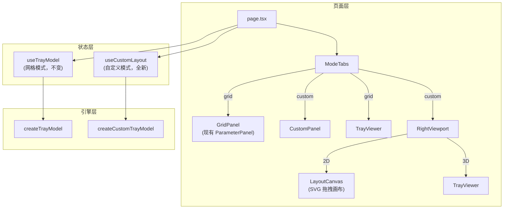

# 布局自定义器（Layout Customizer）— PRD 与开发计划 v2

> 根据用户反馈重大修改：取消方格子限制，采用自由拖拽画布；功能完全独立；右侧面板支持 2D/3D 切换。

---

## 1. 设计变更摘要

| 原方案                           | 新方案                                     |
| -------------------------------- | ------------------------------------------ |
| 固定单位格（32mm），格子对齐放置 | **自由拖拽画布**，凹槽可放置在任意位置     |
| 左侧面板内嵌 2D 网格编辑器       | **右侧面板可切换 2D 画布编辑器 / 3D 预览** |
| 结构参数与网格模式共享           | **完全独立**的参数状态                     |
| `gridRow/gridCol/gridSpan` 定位  | **x/y 坐标**（mm）自由定位                 |

---

## 2. 功能设计（更新后）

### 2.1 UI 布局

```
┌──────────────────────────────────────────────┐
│                  Header                       │
├──────────────────────────────────────────────┤
│  [⬛ 网格模式]  [⬜ 自定义模式]                 │  ← 标签页
├──────────────┬───────────────────────────────┤
│  参数面板     │  [2D 编辑] [3D 预览]   ← 子标签 │
│  (凹槽列表    │                                │
│   结构参数    │     2D 拖拽画布                  │
│   操作按钮)   │     或 3D 预览视口               │
└──────────────┴───────────────────────────────┘
```

### 2.2 自定义模式 — 左侧面板

| 区域     | 内容                                                                    |
| -------- | ----------------------------------------------------------------------- |
| 托盘尺寸 | 宽度 / 深度 滑块（mm），定义底板物理尺寸                                |
| 添加凹槽 | 底座预设按钮组（25/28.5/32/40/50/60mm），点击后在画布中央添加一个新凹槽 |
| 凹槽列表 | 当前已添加凹槽的列表（尺寸 + 坐标），可删除                             |
| 结构参数 | 独立的 spacing/baseThickness/holeDepth/cornerRadius                     |
| 模型尺寸 | 显示托盘实际宽/深/高                                                    |
| 操作按钮 | 锻造 / 导出 STL / 重置                                                  |

### 2.3 自定义模式 — 右侧面板

右侧面板通过子标签页切换两个视图：

#### 2D 拖拽画布

- 俯视图展示托盘轮廓（矩形边框）
- 凹槽渲染为 **圆形**，按尺寸着色
- 用户可 **拖拽** 圆形改变位置
- **碰撞检测**：拖拽时实时检测圆-圆碰撞和圆-边界碰撞，防止重叠
- 拖拽时显示位置辅助线（可选）
- spacing 参数作为 **边距**（凹槽距托盘边缘的最小距离）

#### 3D 预览

- 复用现有 `TrayViewer` 组件

### 2.4 数据模型

```typescript
/** 自由放置的凹槽 */
interface FreeSlot {
  id: string; // 唯一标识（UUID）
  x: number; // 中心 X 坐标 (mm)，相对于托盘左下角
  y: number; // 中心 Y 坐标 (mm)，相对于托盘左下角
  diameter: number; // 凹槽直径 (mm)
}

/** 自定义布局参数（完全独立） */
interface CustomLayoutParams {
  trayWidth: number; // 托盘宽度 (mm)
  trayDepth: number; // 托盘深度 (mm)
  slots: FreeSlot[]; // 凹槽列表
  spacing: number; // 边距 (mm)
  baseThickness: number;
  holeDepth: number;
  cornerRadius: number;
}
```

### 2.5 碰撞检测逻辑

```
圆-圆碰撞：dist(A, B) >= (rA + rB + tolerance)
圆-边界约束：
  x - r >= spacing
  x + r <= trayWidth - spacing
  y - r >= spacing
  y + r <= trayDepth - spacing
```

> 拖拽时实时校验，碰撞时约束位置（snap 到最近合法点）或显示红色警告。

### 2.6 建模逻辑

- 底板：`trayWidth × trayDepth`，圆角矩形拉伸
- 凹槽：遍历 `slots`，每个生成 `cylinder({radius: (diameter + HOLE_TOLERANCE) / 2})`
- 凹槽中心坐标从 `(x, y)` 转换为 JSCAD 坐标系（原点在底板中心）：
  ```
  jscad_x = x - trayWidth / 2
  jscad_y = y - trayDepth / 2
  ```

---

## 3. 实现难点分析

| 难点                | 复杂度 | 方案                                                                   |
| ------------------- | ------ | ---------------------------------------------------------------------- |
| **2D 画布拖拽交互** | ⭐⭐⭐ | 使用 SVG（更适合与 React 集成，DOM 事件天然支持拖拽）而非 Canvas       |
| **坐标系映射**      | ⭐⭐   | mm 物理坐标 ↔ 像素坐标，需要缩放系数 `scale = viewportSize / traySize` |
| **实时碰撞检测**    | ⭐⭐   | 凹槽数量少（<20），O(n²) 暴力检测即可                                  |
| **拖拽约束**        | ⭐⭐⭐ | 碰撞时需要计算最近合法位置，而非简单阻止移动                           |
| **视口自适应**      | ⭐⭐   | 托盘尺寸变化时，画布缩放比例要实时调整                                 |
| **状态完全独立**    | ⭐     | 独立的 state/hook，不与网格模式共享                                    |

---

## 4. 目标架构



---

## 5. 开发计划

### Phase 1: 基础设施

- 安装 shadcn Tabs 组件
- 新增 `FreeSlot` / `CustomLayoutParams` 类型定义
- 新增自定义模式配置常量

### Phase 2: 建模引擎

- 实现 `createCustomTrayModel(params: CustomLayoutParams): Geom3`
- 实现 `calculateCustomTrayDimensions(params)`

### Phase 3: 状态管理

- 新建 `useCustomLayout` hook（完全独立于 `useTrayModel`）
- 管理：customParams、slots CRUD、拖拽位置更新、碰撞检测、模型生成/导出

### Phase 4: UI 组件

- `ModeTabs` — 顶部标签页切换
- `LayoutCanvas` — SVG 2D 拖拽画布（核心组件）
- `CustomPanel` — 左侧参数面板
- `ViewportToggle` — 右侧面板 2D/3D 切换

### Phase 5: 页面整合

- 修改 `page.tsx`，根据模式渲染不同面板和视口

### Phase 6: 导出适配

- 自定义模式 STL 文件名、导出逻辑

---

## 6. 文件变更总览

| 文件                              | 操作   | 说明                                        |
| --------------------------------- | ------ | ------------------------------------------- |
| `src/types/custom-tray.ts`        | NEW    | `FreeSlot`, `CustomLayoutParams`, `AppMode` |
| `src/lib/config.ts`               | MODIFY | 自定义默认值、颜色映射                      |
| `src/lib/custom-tray-model.ts`    | NEW    | 自定义建模引擎                              |
| `src/lib/stl-export.ts`           | MODIFY | 导出文件名适配                              |
| `src/hooks/useCustomLayout.ts`    | NEW    | 自定义模式独立 hook                         |
| `src/components/ModeTabs.tsx`     | NEW    | 标签页                                      |
| `src/components/LayoutCanvas.tsx` | NEW    | SVG 2D 拖拽画布                             |
| `src/components/CustomPanel.tsx`  | NEW    | 自定义模式左侧面板                          |
| `src/app/page.tsx`                | MODIFY | 双模式整合                                  |

---

## 7. Verification Plan

1. `npm run build` — 编译无错误
2. 浏览器验证：
   - 标签页切换正常，模式间状态互不影响
   - 添加凹槽 → 画布出现圆形
   - 拖拽凹槽位置 → 实时移动，碰撞检测生效
   - 切换 2D/3D → 3D 预览正确反映当前布局
   - 锻造 → 3D 模型正确
   - STL 导出功能正常
