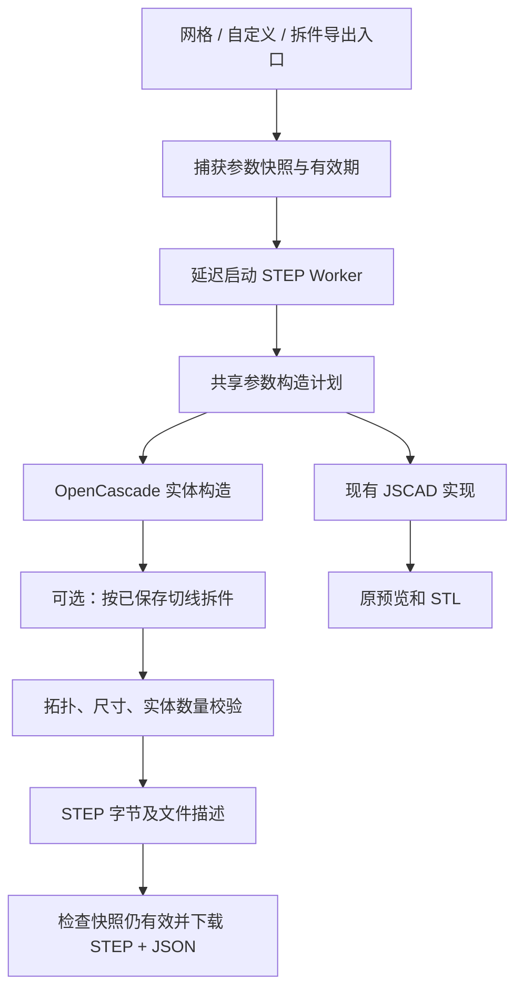

# 网格与自定义模式 STEP 导出开发计划

日期：2026-11-20。

状态：待实施。本文只有计划，不表示下面的任务已完成。

工作分支：`codex/explore-step-export`。探索基线提交：`962e888`。

面向：开发、测试以及后续接手执行的人员。每个任务完成相关检查后独立提交，不将失败或未经验证的任务标记完成。

## 1. 目标与技术决定

在网格、自定义模式中增加 STEP 导出，用户可以把托盘或拆分后的零件带入 CAD 软件继续使用。采用“同一份参数构造数据 → OpenCascade B-rep 实体 → STEP”的路线，保留现有 JSCAD 预览和 STL 出口。

采用 Replicad 包装 OpenCascade，使用按需初始化的独立单线程 Worker。实验版本为 Replicad 1.2.1 和 replicad-opencascadejs 1.2.1；实施时先使用这组已验证版本，升级必须重新验证。

本次开发的默认决定：

1. 模型数据在浏览器本地处理，不新增转换服务器。
2. 圆槽、圆角等可解析轮廓使用真实圆弧和曲面；其他现有轮廓先保留其采样形状，明确标记为“包含分段轮廓”。不把超椭圆替换成标准椭圆。
3. 导出单位固定毫米，不新增单位设置。
4. 每次导出同时提供当前 JSON 参数。STEP 保留实体几何，不承诺目标软件的草图、约束或特征历史。
5. 现有参数含义、草稿及 JSON 格式保持兼容；导出格式属于操作选择，不写入模型参数。
6. 首版不提供整盘自动拆件、额外连接结构、曲面反求或通用 CAD 建模框架。

## 2. 已知证据与尚未验证的部分

探索报告：[STEP 导出实验](D:/project/mmga/modelling-tools/tray-creator/experiments/step-export/README.md)。可复现脚本：[probe.mjs](D:/project/mmga/modelling-tools/tray-creator/experiments/step-export/probe.mjs)。

已验证的是四个无斜面、矩形外框样本：网格圆槽与磁吸腔、网格矩形槽、自定义圆槽、自定义旋转超椭圆槽。均通过 STEP 写出、同一内核读回、拓扑、体积和外接尺寸检查。最后一种的槽壁仍是分段平面。

现有实验不能证明：全功能几何一致性、商业 CAD 互通、浏览器打包和长期内存稳定性、拆件保留曲面、移动设备性能。

需要延续的具体发现：

- 内核 WASM 约 22.9 MB，gzip 后约 7.3 MB；首次导出才加载，不能进入首页同步依赖链。
- 实验中默认布尔结果面合并使封闭磁吸腔拓扑校验失败；`simplify: false` 后通过。固定版本下先保留这个选择，不增加未验证的自动修复或合并面步骤。
- 普通网格槽的实际切削起点为 `baseThickness - 0.01`，自定义为 `baseThickness`。本计划保留当前行为；如需统一槽深，另立变更及回归，不混入 STEP 接入。
- 现有拆件分区外边界来自多边形，STEP 外框可能是真圆弧，直接相交会削掉曲面边缘。

## 3. 交付分层与支持矩阵

分阶段可交付，但只有“完整覆盖阶段”完成才能宣称覆盖这两个模式。基础阶段对未支持配置禁用 STEP，并显示具体原因；禁止省略特征后继续下载。

| 能力 | 基础阶段 | 完整覆盖阶段 | 独立后续研究 |
| --- | --- | --- | --- |
| 矩形外框、圆角、网格圆槽/矩形槽 | 支持 | 保持 | — |
| 自定义圆槽、旋转、固定/自动尺寸 | 支持 | 保持 | — |
| 自定义超椭圆、外扩、旋转 | 按当前采样轮廓生成实体并提示 | 保持形状语义 | 光滑曲线拟合 |
| 无底孔、磁吸腔、磁铁桩孔 | 支持 | 保持 | — |
| 网格纯底板 | 支持 | 保持 | — |
| 斜面、半圆槽、零间距去岛 | 禁用并说明原因 | 支持 | — |
| 自定义随形/多边形底座、断连多实体 | 禁用并说明原因 | 按现有轮廓支持 | 曲线轮廓恢复 |
| 堆叠盒体与盖子 | 禁用并说明原因 | 独立零件导出 | — |
| 手动拆件 | 分件 STEP 禁用；整件导出标明范围 | 支持当前有效切线和零件编号 | — |
| 阶梯、底盘转换等其他模式 | 不新增入口 | 不在本计划范围 | 单独计划 |

“包含分段轮廓”是形状精度说明，不是失败；“不支持当前配置”是阻断，不能混用。

## 4. 用户操作与导出规则

### 4.1 入口

- 网格与自定义操作区在现有导出位置提供“完整 STL”和“完整 STEP”。不改变其他模式的操作。
- 拆件编辑器提供“分件 STL”和“分件 STEP”，继续使用当前零件树、撤销及切线失效状态。
- 有拆件设置时，完整 STEP 仍导出整件，菜单名称须明确；用户选择分件 STEP 才执行切线。
- STEP 从点击时的参数生成，不依赖旧的 Three.js/JSCAD 预览是否已生成。现有 STL 的预览有效性规则不随之放宽。
- 对采样槽或随形轮廓显示“包含分段轮廓，部分侧壁由平面组成”；不把内核名、算法和调试数据放入用户流程。

### 4.2 状态和取消

显示真实阶段：“加载导出组件 → 构建实体 → 校验模型 → 准备文件”。没有可靠比例时使用阶段提示，不伪造百分比。

同一时间只允许一个 STEP 导出任务。重复点击不重复排队。用户修改几何/拆件参数、导入、重置或切换模式时，旧任务失效并停止下载；已有草稿不受影响。

取消同步 WASM 运算采用终止独立 STEP Worker，再按需重建。发送取消消息不足以中断正在执行的同步布尔计算。超时同样终止 Worker；超时值依据性能样本确定，并在错误文案中说明可重试。

第一次失败后可重试初始化。取消、初始化失败、无效几何、内存不足和文件下载失败需区别报告。

### 4.3 文件与坐标

- 普通整件：一个 `.step` 和一个参数 `.json`。
- 同一自定义底座有多个独立实体：整件 STEP 在同一文件中保存多个具名实体，保持原始相对位置；不把断开的实体缝成一个实体。
- 手动分件：每个叶子零件一个 `.step`，加一份完整拆件参数 JSON；文件名复用稳定零件编号，如 `part_1-2`。
- 盒体与盖子：各一个 STEP，加一份参数 JSON；使用真实构造位置，不导出三维预览中旁移展示的位置。
- 整件和盒盖保留模型构造坐标；分件采用现有打印方向规则，允许 0°/90° 旋转、XY 居中和 Z 落地，不带三维展开间距。
- 完整 STEP 不因超过打印尺寸而被阻断；分件 STEP 沿用拆件打印尺寸检查，并使用最终 B-rep 的尺寸复核。
- 所有文件完成并通过校验、快照仍有效后才触发下载。浏览器多文件保存并非事务，不能承诺失败时撤回已经下载的文件。

## 5. 实现结构与现有调用链



### 5.1 构造数据的边界

共享的是尺寸、布局、轮廓描述和布尔构造意图，不共享内核实体。逐段抽取现有逻辑，让 JSCAD 和 STEP 都消费同一计划，避免维护两套容差和坐标算法。

建议新增 `src/lib/flat-tray-construction.ts`，仅容纳本次真实需要的数据：

- 统一模型坐标、外框尺寸、底/顶轮廓及高度。
- 槽轮廓：圆、矩形、现有采样闭合轮廓；放置坐标、旋转和实际切削 Z 区间。
- 原有 `BaseHoleConstructionPlan`，保留其适配失败信息。
- 网格去岛和半圆区域等必须保留的布尔步骤。
- 实体与零件的稳定标识，轮廓是否使用采样的说明。

计划不保存 `TopoDS`、Replicad、Three.js 对象，也不把包含方法的 `ConstructedContouredFootprint` 跨 Worker 传输。随形构造可在 Worker 内完成；向其他边界投影时只保留必要数值和轮廓数据。

短期允许复用现有基于 JSCAD 的二维随形构造，不要求重写轮廓算法。禁止把实验中“从最终多面体反取包围盒重建圆柱”作为生产设计。

### 5.2 STEP 专属模块

建议文件如下；名称可随仓库约定微调，不因此新增通用框架：

| 文件 | 职责 |
| --- | --- |
| `src/lib/step/step-capability.ts` | 根据模式、配置和导出范围给出支持状态、阻断原因、采样提示 |
| `src/lib/step/step-realization.ts` | 把共享构造计划实现为 B-rep；管理对象释放 |
| `src/lib/step/step-validation.ts` | 拓扑、实体数量、尺寸、正体积等验证 |
| `src/lib/step/step-split.ts` | 共享切线在 B-rep 上的裁切与打印变换 |
| `src/lib/step/step-export-service.ts` | 文件命名、快照有效性和伴随参数导出 |
| `src/lib/worker/step.worker.ts` | 内核加载、实体构造、写出，返回可转移字节 |
| `src/lib/worker/step-worker-service.ts` | 单任务状态、请求编号、终止、失败恢复 |

请求最少包含 `requestId`、网格/自定义参数快照、`whole`/`parts` 范围；响应为阶段、成功文件字节及元数据，或具名错误。能力检查在入口和 Worker 执行前都要做，避免参数切换后绕过限制。

初始化采用共享 Promise，失败时清除；不能照搬现有 Worker 构造函数就立即加载内核。WASM URL 由打包生成的资源地址或明确复制的同源版本化资源提供，在任务 2 决定唯一方案，避免两套发布方式。

成功后的 Worker 可复用内核，但每个任务的实体、检查器和虚拟文件都须释放。异常使用 `finally` 清理；取消直接终止 Worker。STEP 字节用可转移 `ArrayBuffer` 返回，避免重复复制大型数据。

### 5.3 必须贯通的现有位置

- 参数及几何：`tray-model.ts`、`custom-tray-model.ts`、`model-utils.ts`、`grid-layout-math.ts`、`slot-definitions.ts`、`base-hole-planning.ts`、`custom-contoured-footprint.ts`、`stackable-box-model.ts`。
- 拆件：`manual-split-plan.ts`、`manual-split-geometry.ts`、`manual-split-cad.ts`；保留切线校验与分区职责。
- 服务：`model-ports.ts`、`grid-model-service.ts`、`custom-layout-service.ts`、`manual-split-model-service.ts`、`model-artifact-bundle.ts`、`model-filenames.ts`。
- UI 调用链：`workspaces/draft-action-area.ts` → `workspaces/grid/useGridWorkspace.tsx` / `workspaces/custom/useCustomWorkspace.tsx` → `PanelActionSection.tsx`；拆件为 `useManualSplitViewport.tsx` → `ManualSplitEditor.tsx`。
- 构建和验收：`package.json`、`pnpm-lock.yaml`、静态资源打包、`verify-worker-bundle.mjs`、`verify-initial-bundle.mjs`、必要的 STEP 集成测试配置。

上述文件范围不是要求全部修改。已有下载模块已经支持具名任意 Blob，应直接复用。当前 `exportModelArtifactBundle` 负责先准备全部文件再下载，但不自行校验快照时效；STEP 服务需要像现有拆件服务一样在下载前检查。

## 6. 分阶段任务和提交边界

### 任务 1：锁定现有几何语义与能力边界

依赖：无。

- [ ] 在探索样本基础上补齐代表参数，记录实际槽深、公差、底孔高度、坐标转换、实体数和尺寸。
- [ ] 建立能力判断与原因文案，区分整件、分件、包含采样轮廓和不支持配置。
- [ ] 为现有槽深 0.01 mm 差异、自动尺寸中心、圆槽快照直径、底孔被阻断等建立语义测试。
- [ ] 为后续任务建立支持矩阵，新增能力时同时更新判断和测试。

涉及：配置和布局函数的现有测试、STEP 能力模块及样本目录。

验收：基础配置可用；盒体、斜面、半圆、随形、零间距去岛、分件等未覆盖配置有明确阻断；非法参数不进入内核。

建议提交：`明确 STEP 导出能力与现有几何语义`。

### 任务 2：验证生产构建中的独立 STEP Worker

依赖：任务 1；在大范围模型抽取前先解决部署风险。

- [ ] 主项目以 pnpm 引入固定版本依赖；实验 npm 依赖不进入产品依赖链。
- [ ] 实现延迟初始化、同源 WASM 定位、失败重试、阶段事件和可转移字节响应。
- [ ] 用最小圆柱/带孔块验证浏览器写出及测试读回；验证取消后 Worker 可重建。
- [ ] 运行静态生产构建与服务，检查 WASM MIME、资源 404、缓存和资源版本匹配。
- [ ] 扩展首屏/Worker 构建检查，防止内核进入首页或原建模 Worker。
- [ ] 保留依赖许可证和来源记录，按固定版本核对发布资源安排。

验收：不点击 STEP 不请求 WASM；首次请求成功；加载失败可重试；原 STL 正常；无依赖共享内存的部署要求。

建议提交：`接入按需加载的 STEP 导出 Worker`。

### 任务 3：抽取普通托盘共享构造计划

依赖：任务 1、2。

- [ ] 提取普通网格和自定义矩形外框、槽位、底孔的数值构造意图。
- [ ] JSCAD 改为消费同一计划，现有拆件 `captureSplitSource` 接口和行为保持兼容。
- [ ] 复用布局、轮廓、孔适配函数，不重新解释旧 JSON 或默认公差。
- [ ] 对尚未迁移的特殊几何保留原实现，STEP 能力检查继续阻断。

验收：原模型关键尺寸、体积、孔腔、槽位及拆件测试通过；固定与自动尺寸、自定义负坐标/旋转/空槽占位语义保持；无用户参数迁移。

建议提交：`共享网格与自定义普通托盘构造计划`。

### 任务 4：实现基础 B-rep 构造与可靠序列化

依赖：任务 3。

- [ ] 支持圆角矩形外框、圆槽/矩形槽、采样超椭圆槽、底孔和网格纯底板。
- [ ] 圆与圆角使用解析曲线；采样槽保持当前外扩、丰满度和旋转。
- [ ] 布尔运算先使用 `simplify: false`；检查最终实体拓扑、有限尺寸和正体积。
- [ ] 设置毫米单位和稳定零件名称；固定并记录实际 STEP schema，避免依赖默认值漂移。
- [ ] 完成成功和异常路径的对象/虚拟文件清理；拓扑失败拒绝下载。
- [ ] 在集成测试中写出、读回并验证实体、尺寸和体积；保留封闭磁吸腔回归。

验收：探索四样本及两类底孔、纯底板、圆角极限、重叠槽等用例通过；不合法拓扑返回定位信息，不产生空文件。

建议提交：`实现普通托盘 STEP 实体导出与校验`。

### 任务 5：打通两种模式的完整 STEP 操作

依赖：任务 4。完成后达到基础阶段交付条件。

- [ ] 接入操作意图、模式工作区、导出菜单和阶段提示；保留原 STL 意图和行为。
- [ ] 使用点击时不可变快照，输出 `.step` 和原参数 JSON。
- [ ] 参数变更、模式切换、重置、取消和连续点击时正确终止或丢弃旧结果。
- [ ] 展示采样轮廓说明和未支持原因，错误信息支持重试。
- [ ] 浏览器实测真实下载、JSON 重导入再生成、无旧快照文件混入。

验收：无需先生成旧预览也可导出 STEP；未支持配置无静默特征丢失；键盘可操作，忙碌/禁用状态可感知。

建议提交：`开放网格与自定义完整 STEP 导出`。

### 任务 6：补齐斜面、半圆槽和零间距规则

依赖：任务 5。

- [ ] 从现有逻辑抽取底/顶外框与高度规则，构造斜面实体；圆角消失和极小半径分支单独处理。
- [ ] 保留半圆槽的上层半边主体与整块底板语义，而不是简单把整个托盘切半。
- [ ] 保留网格零间距中心清除体、外围槽和矩形槽整体容差规则。
- [ ] 验证组合配置，逐项解除能力阻断。

验收：圆角半径为零/接近极限、斜面大于圆角、横纵半圆、X/Y 独立间距、两个方向零间距均保持几何语义；体积检查以实际构造定义为准。

建议提交：`支持特殊网格结构和侧面斜面的 STEP 导出`。

### 任务 7：支持自定义随形、多边形和多实体

依赖：任务 6。

- [ ] 复用权威轮廓构造结果，正确处理外环、内孔、绕序和断连分量。
- [ ] 多边形手调圆角/相切方式保持原结果；当前只有采样轮廓时如实输出，不强行拟合。
- [ ] 每个独立实体分配确定性名称，保持相对位置并验证实体数量。
- [ ] 轮廓构造失败、空轮廓和历史参数按现有规则处理，不替换成任意矩形。

验收：随形单体、断连双体、内孔、两类多边形圆角和旋转外扩槽通过；导出重开实体数量正确。

建议提交：`支持自定义复杂底座与多实体 STEP`。

### 任务 8：支持盒体与盖子

依赖：任务 6、7。

- [ ] 共享盒壳、顶部/底部配合、斜面及盖子的构造尺寸，保留装配间隙。
- [ ] 槽和底孔复用已完成的构造计划，按原可用组合执行。
- [ ] 盒体/盖子分别验证、命名并全部准备后下载；不沿用预览旁移。

验收：网格与自定义盒体、盖子、底孔、纯底板等有效组合尺寸与间隙正确；任何一个零件失败时不开始下载；维持现有盒体不可手动拆件限制。

建议提交：`支持盒体与盖子的 STEP 文件导出`。

### 任务 9：验证并实现 B-rep 手动拆件

依赖：任务 6、7。可与任务 8 顺序交换，禁止为赶进度跳过曲面边界验证。

- [ ] 复用已保存路径、途经点结果和 `replayManualCuts` 校验；导出不重新规划候选。
- [ ] 先验证两点直线和折线裁切：内部切线不动，只有路径外端沿既有方向延长至越过真实外壁，形成完整裁切面/体。
- [ ] 为凹外轮廓、多实体和连续分件验证端点延长是否引入额外交叉；无法唯一确定时拒绝，不能移动切线或扩大所有边。
- [ ] 以真实 B-rep 裁切拓扑保留曲面外壁；不直接使用内接采样外环裁掉原实体。
- [ ] 在真实曲面上复核凹槽/底孔保留距离；多边形保护区通过不等于解析曲面距离必然通过。
- [ ] 验证每次分割的正体积、期望连通分量、共享切面和总体积守恒，确认叶子编号对应关系。
- [ ] 对最终零件进行 0°/90° 打印适配与落地变换；超平台或切线失效时明确阻断。
- [ ] 接入拆件 UI 和按件导出服务，完成旧 JSON 切线往返测试。

验收：圆角外框中点、斜面、折线绕槽、连续拆分、随形凹边、底孔附近、独立多实体通过；无切缝凭空增厚/缺料，零件编号稳定。暂无法支持的组合继续禁用，不宣称完整分件支持。

建议提交：`支持保留曲面边界的手动分件 STEP 导出`。

### 任务 10：完成发布验收与文档

依赖：任务 5–9 全部完成。

- [ ] 执行第 7 节完整验收；检查原 STL、预览、草稿和参数导入回归。
- [ ] 验证完整静态部署的冷加载、离线缓存行为、取消后重试及大模型超时恢复。
- [ ] 记录连续导出内存和性能，不以一次 Node 实验代替浏览器验收。
- [ ] 在 FreeCAD 中导入代表文件并做至少一次后续布尔操作；用户指定其他目标 CAD 后补充对应互通记录。
- [ ] 更新用户说明、支持矩阵、依赖记录和故障排查；移除已不需要的实验复制实现或明确其历史用途。

验收：无未解释的失败；未验证软件/设备明确列出；不能把“下载成功”当作“CAD 可编辑性验收通过”。

建议提交：`完成 STEP 导出部署与互通验收`。

## 7. 验收矩阵、精度和性能门槛

### 7.1 校验分层

| 层级 | 检查内容 | 运行时机 |
| --- | --- | --- |
| 参数/能力 | 规范化、有限值、尺寸边界、孔适配、当前组合支持状态 | 每次导出 |
| 共享计划 | 坐标、旋转、容差、槽深、内外环、稳定编号 | 单元测试；构建时必要校验 |
| B-rep | 有效拓扑、实体数量、非空正体积、尺寸 | 每次导出 |
| 分件 | 切线有效性、曲面安全距、体积守恒、打印尺寸 | 每次分件导出 |
| STEP 往返 | 单位、名称、几何、实体数量、外接框和体积 | 真实内核集成测试 |
| UI/异步 | 状态、重试、取消、快照变化、不部分准备下载 | 服务测试与浏览器实测 |
| 外部 CAD | 导入、识别实体、后续布尔、盒盖/多件位置 | 发布验收 |

暂定数值门槛，任务 1 建立基线后记录必要调整及理由：

- STEP 往返：外接框各坐标差 ≤ 0.001 mm；体积绝对差 ≤ `max(0.001 mm³, 原体积 × 1e-8)`。
- 分件总体积：差 ≤ `max(0.01 mm³, 整件体积 × 1e-6)`；另检查重叠和缺口，不能用总体积相互抵消掩盖错误。
- 与 JSCAD 比较：外尺寸逐项核对；普通样本体积相对差 0.2% 仅作报警基线，不作为所有模型的通用正确性证明。薄壁/大量曲面需与解析尺寸或高精度参考截面比较。
- 验证孔径、槽底 Z、关键壁厚和间隙，不仅比较包围盒。曲面圆与当前内接多边形有合理差异，必须可解释并记录。
- 分件安全距离按参数 `clearance` 检查，数值容差不得被用来静默放宽用户保留距离。

### 7.2 代表用例

至少覆盖：四个探索样本；默认 2×5 网格；1×1；X/Y 独立间距；圆/矩形零间距；纯底板；两种底孔及不适配孔；极限圆角/斜面；横纵半圆；自定义固定/自动尺寸、旋转、负坐标、空布局；超椭圆指数和外扩；随形断连、内孔、多边形两类圆角；盒体和盖子；拆件连续路径、失效路径、越界、超平台及非对称布局。

失败用例包括：WASM 404/加载失败、无效输入、拓扑无效、序列化失败、中途取消、参数变化、模式切换、Worker 崩溃、下载异常。通过 mock 验证服务行为，通过真实内核样本验证几何，二者不能互相替代。

### 7.3 性能

记录浏览器、硬件、网络缓存条件及三次运行数据。分别测量冷初始化、热构建、写文件、峰值内存；选 10、50、100 槽及实际可构造的复杂轮廓样本，不宣称覆盖参数允许的所有极端规模。

发布硬门槛：页面交互不被主线程几何运算阻塞；取消立即反馈并终止任务；未请求 STEP 不加载内核；连续 20 次导出后无单调增长的活对象/虚拟文件，失败后可恢复。WASM 内存可能保留高水位，不以 RSS 不立即回落判定泄漏。具体超时与规模上限由测量确定并落实能力检查，不能无限挂起。

### 7.4 检查命令与证据

日常任务运行受影响模块测试；抽取共享建模时必须跑网格、自定义、底孔及拆件回归。STEP 真实内核测试独立于 mock 测试，并在发布检查中显式执行。

```powershell
pnpm test
pnpm lint
pnpm typecheck
pnpm build
git diff --check
```

实施时新增 `pnpm test:step`，包含真实内核往返与分件测试，并纳入发布验收流程；该命令目前不存在，不得按本文声称已经通过。构建后启动现有静态服务做浏览器检查，保存样本参数、文件、统计及验收记录。

## 8. 风险处理与回滚边界

| 风险 | 处理 | 回滚边界 |
| --- | --- | --- |
| 两套几何解释发生漂移 | 共享计划，锁定尺寸与容差；不同内核允许可解释的离散误差 | 任务 3 单独可撤回；原参数无需迁移 |
| WASM 发布或加载失败 | 任务 2 先验证生产静态部署；按需加载，失败可重试 | 隐藏 STEP 入口，原 STL/预览继续使用 |
| 磁吸腔布尔拓扑失败 | 保留原拓扑、明确校验；不自动修复几何 | 该配置 STEP 阻断，保留错误证据 |
| 超椭圆文件面数较多 | 标识采样轮廓并实测；不伪装解析曲线 | 保留现有采样方案，拟合研究另立任务 |
| 拆件切掉真实曲面 | 先验证真实裁切拓扑、边界延伸和安全距 | 分件入口单独关闭，完整 STEP 仍可用 |
| 参数变化导致文件与 JSON 不一致 | 单次快照、下载前时效检查、终止旧任务 | 仅取消本次任务，不修改用户参数 |
| 大模型内存耗尽 | 单任务、及时释放、超时终止、实测能力上限 | Worker 重建；原模式状态不丢失 |

不要在遇到失败时默默退回多面体 STEP、漏掉底孔或改变切线。任何降级输出必须单独作为明确能力定义，不能混入当前出口。

## 9. 独立后续研究：光滑超椭圆与随形曲线

不阻塞上述“保留当前轮廓”的完整覆盖阶段，也不自动扩大本次实现范围。

研究输入应是现有轮廓函数与法向外扩定义，目标是带误差上限的闭合样条，而不是调整长短轴。先验证轮廓偏差、闭合接缝、切向连续性、自交、外扩方向及布尔稳定性，再决定是否提供高质量曲面出口。

可先以最大轮廓偏差 0.01 mm 作为研究目标，但不能只检查拟合节点；需要节点之间的独立密集采样或误差界验证，并检查旋转、极端轴比和外扩样本。达到误差目标仍不等于恢复目标 CAD 特征历史。

## 10. 完成定义与执行顺序

执行顺序：任务 1 → 2 → 3 → 4 → 5，先形成基础可用交付；再执行任务 6 → 7 → 8/9 → 10，完成现有功能覆盖。任务 9 的曲面拆件验证是独立风险门槛，失败时不得宣称分件 STEP 完成。

每次提交说明实际新增支持的配置、测试结果及仍被阻断的配置。只有所有必需任务的验收证据完整，才能将本计划状态改为“完成”。本计划不提供未经测量的日程承诺；目标 CAD 软件和部署环境在对应验收任务开始时确认，不妨碍先实施独立模块。
